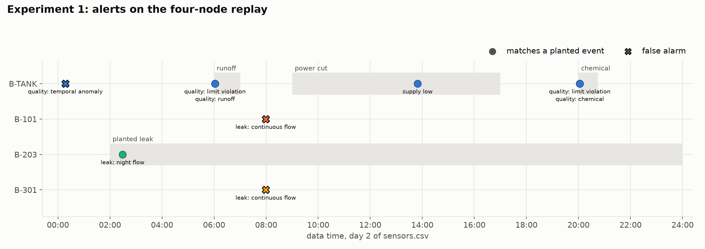
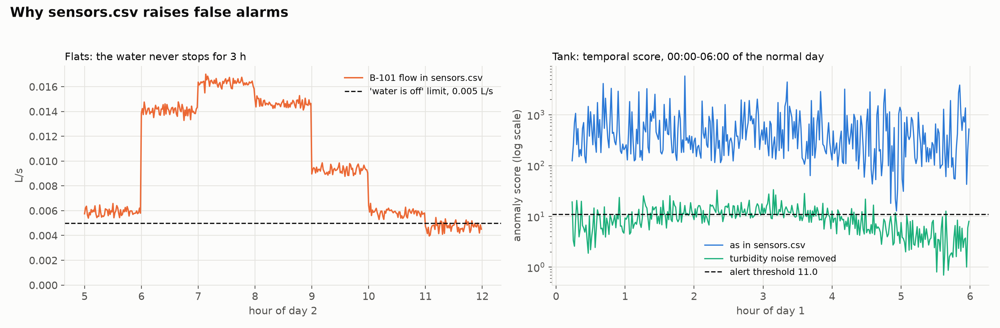
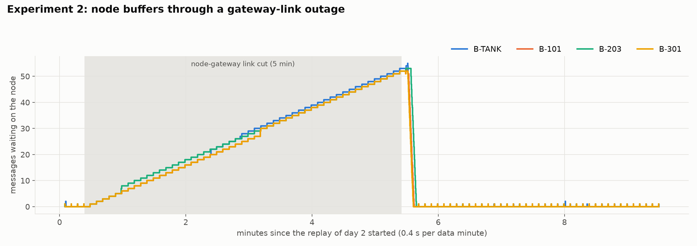
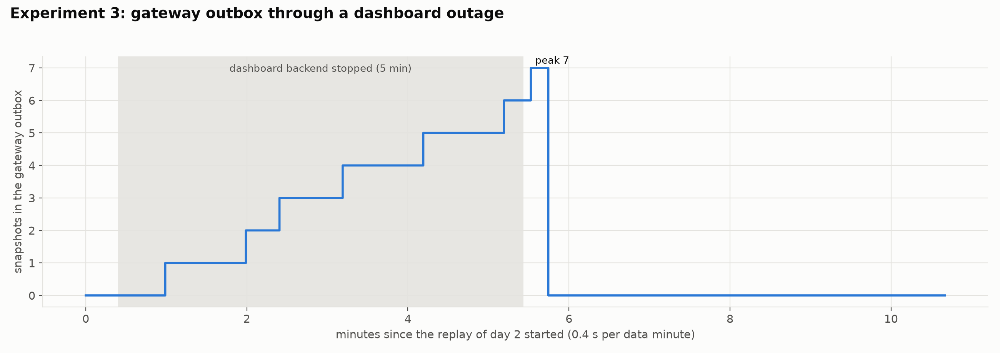
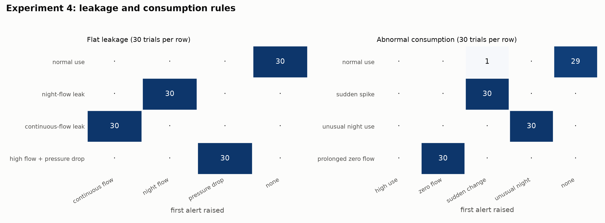
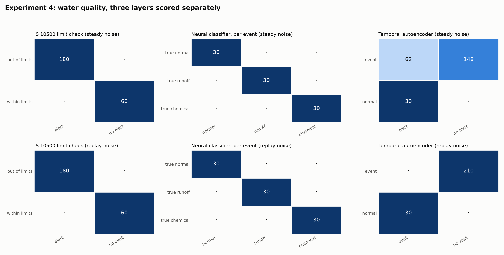
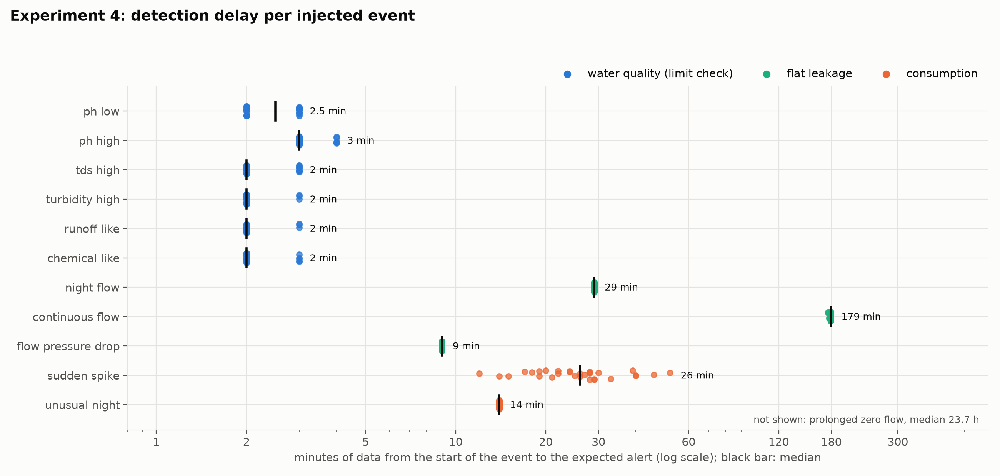
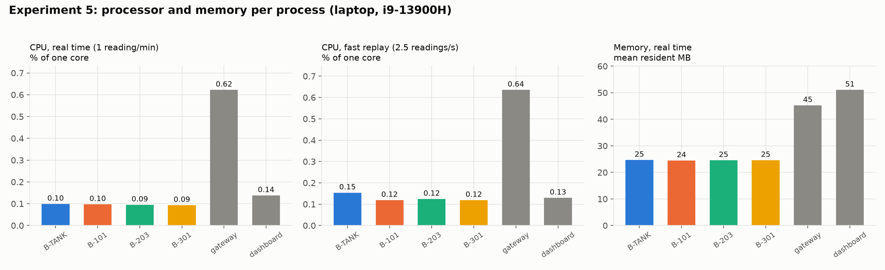
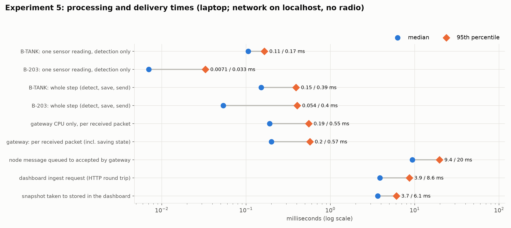

# Experiments: four-node edge system

Run on 2026-11-28 with the code at commit `9c54466`. **All timings, CPU and memory figures are from a
laptop (i9-13900H, 20 threads, 31 GB). Nothing here was measured on a Raspberry Pi.** Nodes and gateway
talk over UDP on localhost, so there is no radio airtime, range or packet loss.

Slide figures are in [results/figures](results/figures), tables (`.md` and `.csv`) in
[results/tables](results/tables).

## How to rerun

```
uv run python -m experiments.system_run baseline         experiments/runs/baseline         --step-s 0.4
uv run python -m experiments.system_run node-outage      experiments/runs/node-outage      --step-s 0.4
uv run python -m experiments.system_run dashboard-outage experiments/runs/dashboard-outage --step-s 0.4
uv run python -m experiments.system_run realtime         experiments/runs/realtime         --realtime-s 540
uv run python -m experiments.detection --trials 30
uv run python -m experiments.report_system
uv run python -m experiments.report_detection
```

The four system runs were run side by side (about 11 minutes). Each process used under 1% of one
core. Raw logs go to `experiments/runs/`, which git ignores. `probe.py` times and logs the system
from outside without editing it, so the timings include a little logging overhead.

In the fast replay one data minute takes 0.4 s. Day 1 is learned first; day 2 is replayed.

## 1. Four-node normal operation



| Node | Messages generated | Accepted by gateway | Delivery | Detections | Match a planted event | False alarms |
|---|---|---|---|---|---|---|
| B-TANK | 105 | 105 | 100% | 6 | 5 | 1 |
| B-101 | 97 | 97 | 100% | 1 | 0 | 1 |
| B-203 | 97 | 97 | 100% | 1 | 1 | 0 |
| B-301 | 97 | 97 | 100% | 1 | 0 | 1 |

All 95 of 95 15-minute summaries per node reached the gateway. The dashboard shows only 14 of 95
blocks per node. Nothing was lost: a snapshot carries only each node's latest summary and is sent every
60 s of wall time or after new decisions, while a block passes every 6 s in this replay. This figure
depends on replay speed and is not a delivery rate.

Full tables: [node summary](results/tables/exp1_node_summary.md), [alerts](results/tables/exp1_alerts.md).

### The false alarms



- **`LEAK_CONTINUOUS_FLOW` (B-101, B-301, 07:59).** The committed `sensors.csv` is older than the
  bursty-demand change to `build_society.py`. Its flats use a smooth hourly pattern, so water never
  stops for long: B-101 stays above the 0.005 L/s limit for 360 minutes on both days, including the
  normal one. The rule alerts at 180 minutes. The B-203 detection is at 02:29 from the night-flow rule,
  during its planted leak.
- **Early `QUALITY_TEMPORAL_ANOMALY` (B-TANK, 00:17).** Turbidity noise in `sensors.csv` is about 51
  times the short-term variation the temporal model was trained on. From 00:00 to 06:00 on the normal
  day the median score is 338 against a threshold of 11.0. Holding turbidity constant lowers it to
  9.1, with 34% of readings still above the threshold, so noise is the main cause but not the only one.
  The model is skipped on the learning day, so it first alerts early on day 2. It closes the tank valve.

In an earlier check (script not included here), the same replay on all 21 nodes closed 21 of 21
valves with the committed data and 2 of 21 (B-203 and B-TANK) with data regenerated by the current
generator. The tank still raised its temporal alert. The repository's dataset was not changed.

## 2. Node-to-gateway outage



Both directions of UDP were dropped for 300.5 s. Because the replay is accelerated, this covered
01:02 to 13:32 in data time. At real speed, five minutes holds only five readings per node.

| Node | Readings processed in outage | Messages waiting at reconnection | Delivered afterwards | Missing | Drain time |
|---|---|---|---|---|---|
| B-TANK | 750 | 53 | 53 | 0 | 11.8 s |
| B-101 | 751 | 52 | 52 | 0 | 12.3 s |
| B-203 | 751 | 52 | 52 | 0 | 14.5 s |
| B-301 | 750 | 52 | 52 | 0 | 11.6 s |

- 396 messages generated, 396 accepted once each. No duplicates were accepted.
- Local detection and valve control continued: B-203 closed at 02:29, B-101 and B-301 at 07:59 (both
  the false alarm above), and the tank raised its 06:02 quality alerts. Every node's detections were
  identical to the baseline run.

[Full table](results/tables/exp2_outage_recovery.md)

## 3. Dashboard outage



The dashboard backend was stopped for 300 s and restarted with the same database. Node links stayed up.

| Measure | Value |
|---|---|
| Snapshots generated in the whole run / while down | 16 / 6 |
| Peak outbox size | 7 (one more was made before the first successful retry) |
| Snapshots made while down that were stored | 6 of 6 |
| Missing / duplicated in the dashboard | 0 / 0 |
| Restart to healthy | 1.0 s |
| Healthy to all outage snapshots stored | 18.7 s (retry backoff, up to 30 s) |
| Node messages accepted / gateway decisions while down | 209 / 8 |

[Full table](results/tables/exp3_dashboard_outage.md)

## 4. Controlled detection

870 trials, 30 per scenario (per noise profile for water). The real node and gateway code ran on a
simulated clock with a lossless in-memory link and no valve. Events with known onset times were
injected into **synthetic** data; `sensors.csv` is not used as proof of accuracy. These scores show
that the rules behave as designed on this data, not how accurate they would be in a real building.

A trial counts as detected if the expected alert starts between the onset and 15 minutes after the
event ends. Precision, recall and F1 are counted per trial.



The matrices show only the **first** alert from each module's own rules. Later and cross-module alerts
are in [expected vs actual](results/tables/exp4_expected_vs_actual.md).

### Flat leakage

All 90 leaks were detected. Median delay: night flow 29 min, continuous flow 179 min, flow with
pressure drop 9 min. Precision, recall and F1 are 1.00 **on the four main scenarios only**.

Boundary cases, scored separately:

| Case | Result |
|---|---|
| 20 min night flow; 150 min flow; pressure drop without high flow | no alert during the event (30/30 each) |
| High flow without pressure drop | `SUDDEN_CONSUMPTION_CHANGE`, 30/30 |
| Long legitimate use | continuous-flow leak, high use and sudden change, 30/30 |

The rules cannot tell long legitimate use from a leak. Counting those trials, continuous-flow
precision would fall from 1.00 to 0.50.

### Abnormal consumption

| Scenario | Detected | False positives | Precision | Recall | F1 | Median delay |
|---|---|---|---|---|---|---|
| Sudden spike | 30/30 | 32 | 0.48 | 1.00 | 0.65 | 26 min |
| Unusual night use | 30/30 | 4 | 0.88 | 1.00 | 0.94 | 14 min |
| Prolonged zero flow | 30/30 | 1 | 0.97 | 1.00 | 0.98 | 23.7 h |

30 of the 32 spike false positives are one repeat in every spike trial: `SUDDEN_CONSUMPTION_CHANGE`
starts again 4 to 5 hours after the spike ends. It is probably an after-effect of the rule's six-hour
average. The other 2 come from other scenarios.

### Water quality: three layers, kept separate



"Steady" is low sensor noise; "replay" is the noise level of `sensors.csv`.

| Layer | Steady noise | Replay noise |
|---|---|---|
| IS 10500 limit check (180 out-of-limit, 60 within) | P 1.00, R 1.00, F1 1.00; median 2 min | same |
| Neural classifier, runoff and chemical, per event | P 1.00, R 1.00, F1 1.00 | same |
| Temporal autoencoder (210 events, 30 normal) | P 0.22, R 0.30, F1 0.25 | P 0.00, R 0.00, F1 0.00 |

- The classifier also labelled all 30 normal trials normal at each noise level, and every reading
  inside runoff and chemical events correctly. It labels single-parameter faults too (turbidity as
  runoff, pH and TDS as chemical); those are not scored as classification.
- The temporal model alerted in every normal trial at both noise levels. Only a new alert counts as a
  detection, so an earlier false alarm that is still active hides the event. With replay noise this
  happens every time.
- **There is no temperature limit on `main`.** High temperature raised no limit alert; the temporal
  model fired during 5 of 30 steady-noise trials.

### Latency and node identification



The gateway named the injected node for all 540 detected events. Across 840 node-days of normal flats
running beside the injected ones there were 26 alerts (24 unusual night use, 2 sudden change) and no
leak alerts.

Score tables: [leak](results/tables/exp4_leak_scores.md),
[consumption](results/tables/exp4_consumption_scores.md),
[limit check](results/tables/exp4_water_limit_check_scores.md),
[classifier](results/tables/exp4_water_classifier_event_scores.md),
[temporal](results/tables/exp4_water_temporal_scores.md).

## 5. Resource use (laptop only)



| Process | CPU at real time (% of one core) | CPU in fast replay | Mean resident memory, real time |
|---|---|---|---|
| Each node | 0.09 to 0.10 | 0.12 to 0.15 | about 25 MB |
| Gateway | 0.62 | 0.64 | 45 MB |
| Dashboard | 0.14 | 0.13 | 51 MB |

The real-time run is 9 minutes, only about 9 readings per node, so its CPU figure is mostly idle
polling.



| Measure, fast replay | Median | 95th percentile |
|---|---|---|
| Detection per reading, tank | 0.11 ms | 0.17 ms |
| Detection per reading, flat (B-203) | 0.007 ms | 0.033 ms |
| Whole node step, tank | 0.15 ms | 0.39 ms |
| Gateway, per packet | 0.20 ms | 0.57 ms |
| Message queued on node to accepted by gateway | 9.4 ms | 20 ms |
| Dashboard ingest request | 3.9 ms | 8.6 ms |

A Pi will be slower, by an amount these runs do not show.
[All latencies](results/tables/exp5_latency_ms.md), [CPU and memory](results/tables/exp5_cpu_memory.md).
