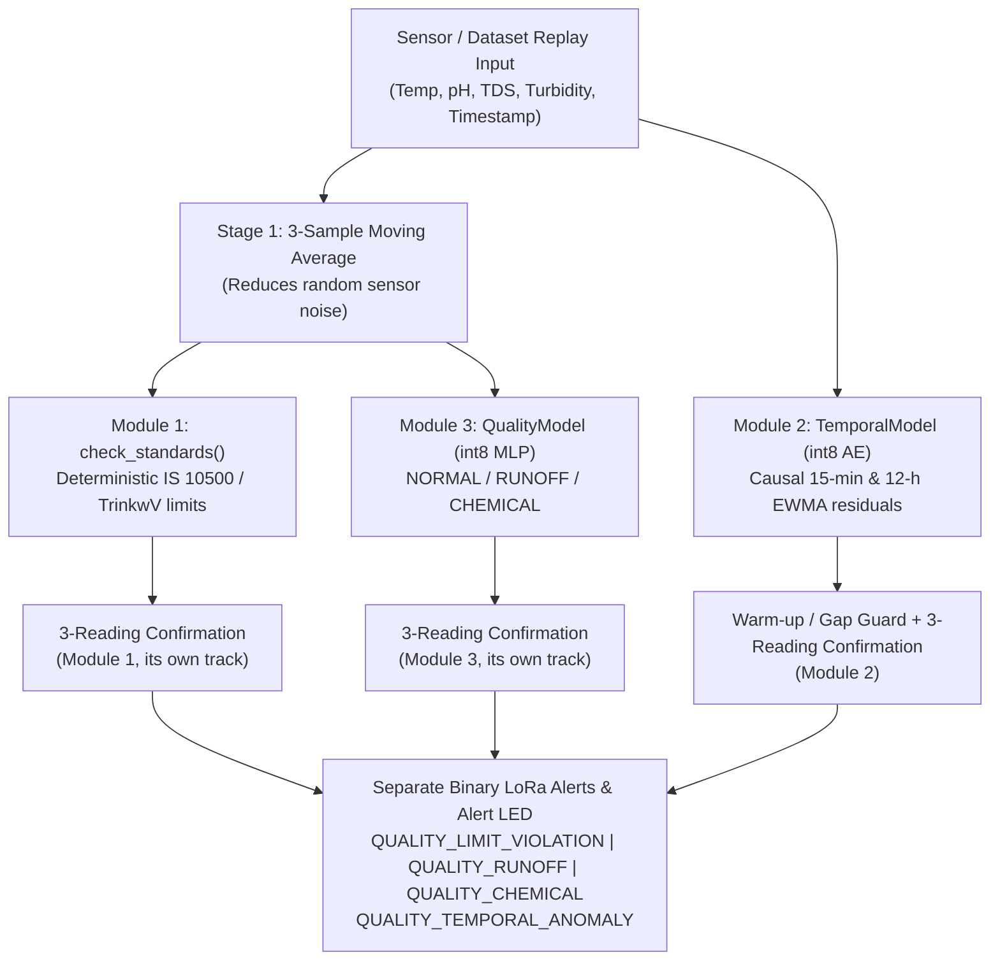

# JalRakshak / Aqua Edge: Water-Quality TinyML Documentation

## Code and self-check

| File | Runs on | What it does |
|---|---|---|
| `quality_model.py` + `quality_model.json` + `temporal_model.json` | Edge node | Offline 3-module water-quality stack (pure Python, `int8`): **Module 1** (`check_standards`, authoritative IS 10500 / *TrinkwV* limits), **Module 2** (`TemporalModel`, 432 B `int8` Temporal AE for subtle temporal anomalies), and **Module 3** (`QualityModel`, 324 B `int8` 4-feature classifier: `NORMAL` / `RUNOFF` / `CHEMICAL`) |

Self-check, from the repository root: `python3 -m tinyml.quality.quality_model`.

---

## 1. Overview

This document explains the design, experiments, evaluation results, and final architecture of JalRakshak's offline water-quality monitoring subsystem in `tinyml/quality/` and `edge/`.

Unlike leakage (`../leakage/`) and abnormal water consumption (`../consumption/`), which use lightweight statistical and compression-rate rules, water-quality monitoring combines three separate on-node components:
1. **Module 1 (`check_standards`):** An authoritative deterministic check against drinking-water limits (IS 10500:2012 or German *TrinkwV*).
2. **Module 2 (`TemporalModel`):** An 8-bit (`int8`) Temporal Autoencoder (`432 bytes` of weights and biases) that tracks short-term and persistent changes over time to catch unusual water behaviour that fixed limits miss.
3. **Module 3 (`QualityModel`):** A 4-feature `int8` classifier (`324 bytes` of weights and biases) that provides secondary contamination-pattern labels (`NORMAL`, `RUNOFF`, or `CHEMICAL`).

If temperature is missing or `NaN`, only Module 1 runs: no stand-in temperature is fed to either model. If pH, TDS or turbidity is missing, none of the three runs.

All three modules run locally in pure Python (standard library only, no cloud or TensorFlow Lite dependency). The target is a Raspberry Pi 3B edge node; so far they have only run on development machines.

---

## 2. Why TinyML and Why Multiple Detection Approaches?

A water-quality monitor tracks four parameters: **Temperature (°C)**, **pH**, **Total Dissolved Solids (TDS, in ppm)**, and **Turbidity (NTU)**.

Checking each sensor alone against fixed upper/lower limits is necessary for safety, but it has two limits:
1. **Regulatory compliance checking** asks: *"Does this sample break a legal drinking-water limit (for example, pH outside 6.5 to 8.5, TDS above 500 ppm, or turbidity above 5 NTU)?"* A simple `if/else` rule already answers this exactly. A neural network should not be used just to approximate an `if/else` rule.
2. **Water-quality anomaly detection** asks: *"Is the water behaving abnormally compared to its recent history, even if individual sensors have not crossed a legal limit yet?"* For example, a subtle chemical leak or sensor-correlation shift in a utility pipe can appear as a sudden multi-sensor change while still sitting inside static limits.
3. **Contamination-pattern classification** asks: *"If the water is unsafe, does the multi-sensor pattern look more like surface/rainwater runoff or a chemical spill?"* A binary limit check cannot separate those causes on its own.

Because these three questions are different, a single model should not be asked to solve all of them. Our experiments showed why separating them into three distinct modules is necessary.

---

## 3. System Architecture

The water-quality subsystem runs on the monitoring node inside [tinyml/quality/quality_model.py](quality_model.py) and [edge/aqua_edge.py](../../edge/aqua_edge.py) (`EdgeRuntime._check_tank`, used by `TankNode` and `combined` mode), and encodes its alerts in [hal/packet.py](../../hal/packet.py).

---

## 4. Original Three-Class Classifier

Following Sharma et al. [1], the initial goal was a compact on-device neural network that classifies water into three classes: **NORMAL**, **RUNOFF**, and **CHEMICAL**.

- **Architecture:** `4 -> 16 -> 8 -> 3` multilayer perceptron (MLP) with ReLU hidden layers and a 3-class output.
- **Input features and preprocessing:** `[Temperature_C, pH, log1p(TDS_ppm), log1p(Turbidity_NTU)]`. Log transforms (`log(1 + x)`) compress TDS and turbidity, which span more than three orders of magnitude. Each feature is standardized using the training mean and standard deviation.
- **Note on earlier branch history:** An earlier version on `live-simulation` dropped temperature (using `3 -> 16 -> 8 -> 3`) because `Unsafe` river/lake rows in the Kenya dataset happened to be warmer (`~26 °C`) than `Safe` tap water (`~22 °C`), which caused the model to associate warmer water with contamination. We restored the 4-input shape from Paper [1] and fixed the shortcut by sampling temperature from an overlapping range across all three classes.
- **Training and quantization:** Trained in NumPy with Adam (`50` epochs, learning rate `0.01`, batch size `128`) using Stratified 5-Fold Cross-Validation, then quantized post-training to `int8` weights (`-127..127`) and `int32` biases with calibrated activation scales (mirroring TensorFlow Lite Micro).
- **Firmware inference and footprint:** `QualityModel` in [tinyml/quality/quality_model.py](quality_model.py) runs integer-only matrix multiplications in pure Python (`216` `int8` weights + `27` `int32` biases = `324 bytes`; `1,450 bytes` in [tinyml/quality/quality_model.json](quality_model.json)).
- **Why synthetic mixtures were needed:** No public IoT water-quality dataset we found provides verified `RUNOFF` and `CHEMICAL` labels across all four sensor channels. Synthetic mixtures were built from real `Safe` tap-water readings mixed with simulated runoff or chemical solutions and labeled using IS 10500:2012 limits.
- **Limitation of synthetic labels:** Because labels came from synthetic mixing ranges and IS 10500 cutoffs, the original model could achieve very high cross-validation accuracy by memorizing simple feature ranges rather than learning true physical contamination signatures.

---

## 5. Datasets and Their Roles

All datasets are stored locally under `tinyml/quality/data/` (excluded from Git via `.gitignore`) and are not included in the repository.

| Dataset | Source / Reference | Measured Parameters Used | Role in This Project | Key Limitation |
|---|---|---|---|---|
| **Kenya Water Sources** | Ooko et al. (2026), Mendeley `575ctg3nnr/2` | `Temperature_C`, `pH`, `TDS_ppm`, `Turbidity_NTU`, `Label` (`Safe`/`Unsafe`) | `Safe` rows used as base tap water for 5-fold CV and held-out FPR; `Unsafe` rows used for external TPR | `Safe`/`Unsafe` labels reflect water source type, not verified runoff vs. chemical causes |
| **GECCO 2019** | Thüringer Fernwasserversorgung, Zenodo `4304080` | `Tp` (°C), `pH`, `Cond` (converted via `0.65 * 1e4`), `Turb` (NTU), `Event` | External German drinking-water utility time series (`218,880` rows at 1-min intervals; after dropping rows with a missing input, `216,294` remain: `215,690` normal + `604` event, `476` of them in the second half) | Normal German pH exceeds 8.5 in 81.1% of readings (compliant under German *TrinkwV*, outside IS 10500); low event prevalence (`0.44%` in test half) |
| **CSU ROSS 2019** | Poudre Water Quality Network, HydroShare `521e317e...` | `Temperature` (°C), `pH`, `Specific Conductivity` (via `0.65`), `Turbidity` (NTU) | External environmental river dataset (`44,133` aligned QA/QC rows, `-0.1` to `20.7 °C`) | Natural river water, not treated tap water; cannot serve as a drinking-water compliance ground truth |
| **Loddon Catchment** | UKCEH / EIDC `10.5285/331659d7...` | `SONDETEMP`, `SONDEPH`, `SONDECOND`, `SONDETURBIDITY`, storm sample timestamps | External hourly river monitoring (`8,322` rows) + storm-sample windows (`207` matched hours) | Naturally turbid river water; storm-autosampler timestamps mark when samples were taken, not that baseline river hours are "safe" |
| **Mendeley 2019 WSN** | Sithole et al. (2019), Mendeley `pbb76sbbrg/1` | `pH m`, `Cm (µS/cm)` (Tables 1-6 only), `LDR m (kΩ)` | Exploratory physical contamination diagnostic (`10` lab experiments, `N=26` each) | Missing temperature; turbidity is uncalibrated `LDR (kΩ)` instead of NTU; Tables 7-10 omit conductivity. Excluded from quantitative evaluation and training |

### Detailed Dataset Notes
- **Kenya Water Sources:** `Safe` rows (`treated tap and bottled water`) provide realistic baseline tap readings. They were split into source folds *before* generating synthetic mixtures so closely related mixtures never span train and validation folds.
- **GECCO 2019:** Evaluates both cross-utility normal-water false positives and real labelled utility anomalies (`Event == TRUE`). Under German *TrinkwV* (`pH 6.5-9.5`, `TDS <= 1625 ppm`), `215,688` of `215,690` normal readings are compliant, whereas `81.13%` have `pH > 8.5` (exceeding IS 10500). Flagging German-compliant alkaline water under an IS 10500 model reflects a standard difference, not model overfitting.
- **CSU ROSS 2019:** Provides both `value_raw` and `value_final` (QA/QC-cleaned) measurements across wide seasonal temperatures (`-0.1` to `20.7 °C`), testing whether the classifier remains stable on IS-10500-compliant environmental rows.
- **Loddon Catchment:** Hourly sonde measurements (`HighFrequencySensorDataFlowandSonde.csv`) were matched by date and hour to storm-event sampling timestamps (`StormWaterQualityData.csv`). Because River Loddon's median turbidity is `~10 NTU` even outside storms (only `3.8%` of all hours meet IS 10500 drinking-water limits), drinking-water thresholds cannot treat non-storm river hours as "normal" or storm hours as isolated "runoff events." Loddon is therefore documented as an incompatible external dataset for judging drinking-water storm-runoff performance, and the model was not tuned against it.
- **Mendeley 2019 WSN:** Contains 10 physical lab experiments at room temperature (`pure tap water`, `soil`, `chlorine`, `salt`, `washing powder`, `vinegar`, and 4 multi-contaminant mixtures). Because `LDR (kΩ)` cannot be treated as NTU without a physical sensor calibration curve, conductivity-to-TDS conversion varies by ionic composition, temperature is missing, and Tables 7-10 lack conductivity, Mendeley 2019 was excluded from quantitative NTU-based accuracy reporting and was **never used in retraining**. In an exploratory check (no script for it is in the repository) using an uncalibrated proxy, it still revealed two conceptual gaps in the original training data: cloudy `washing powder` and acidic `vinegar` were both misclassified as `RUNOFF`.

---

## 6. Original Classifier Failure Analysis

To test whether the original 3-class classifier learned multi-sensor contamination patterns or simple range shortcuts, we ran an overlap experiment using held-out Kenya source samples. The script and original model for this experiment are not in the current `tinyml/quality/` code, so the figures in this section are a historical record that cannot be regenerated from it:
- In the original training mixtures, `RUNOFF` always had high turbidity (`10-300 NTU`), while `CHEMICAL` was always clear alkaline water (`0.2-3 NTU`, `pH 10.5-12.5`).
- When tested on an overlapping region (`pH 6.2-8.7`, `TDS 80-600`, `Turbidity 6-60 NTU` for runoff vs. `pH 6.5-10.5`, `TDS 350-1500`, `Turbidity 0.5-12 NTU` for chemical), **`37.4%` (`1,092 / 2,920`) of chemical samples were misclassified as `RUNOFF`**.
- Inside the strict overlap sub-box (`pH 6.5-8.7`, `TDS 350-600`, `Turbidity 6-12 NTU`), **`100%` (`182 / 182`) of chemical samples were misclassified as `RUNOFF`**.

**Conclusion:** High cross-validation accuracy on non-overlapping synthetic data hid a univariate shortcut (`Turbidity > ~5 NTU -> RUNOFF`).

---

## 7. Retraining Methodology

To fix those shortcuts, `tinyml/quality/train_quality.py` was updated as follows. No rows from `GECCO`, `CSU ROSS`, `Loddon`, or `Mendeley 2019` are used for training. The evaluation is not fully independent of GECCO, though: the `NORMAL` pH range was chosen with GECCO's water in mind (item 3), and the script ends by asserting `FPR <= 0.05` on GECCO's IS-compliant normal rows. Turbidity, pH and TDS ranges below for `RUNOFF` and `CHEMICAL` describe the contaminant before it is mixed into tap water. A mixture is labelled with its contaminant class only if it breaks an IS 10500 limit; otherwise it is labelled `NORMAL`. Classes are then balanced.
1. **Expanded `RUNOFF` regime:** Varied concentrations from `2.5` to `300 NTU`, `pH 5.4-7.4`, and low-to-moderate TDS (`10-250 ppm` endmember).
2. **Expanded `CHEMICAL` regimes:** Included **acidic** (`pH 2.0-5.0`), **neutral high-TDS** (`pH 6.5-8.5`), and **alkaline** (`pH 9.5-12.5`) chemicals across overlapping turbidity (`0.2-80 NTU`).
3. **Expanded `NORMAL` municipal pH envelope:** Covered `pH 6.55-8.49` so legitimate alkaline municipal supplies (such as GECCO's IS-compliant `pH ~8.48` water) are represented. The range applies before sensor noise (`sigma = 0.05`) is added.
4. **Overlapping temperature (`4-35 °C`):** Sampled identically across all three classes.
5. **Leakage-free 5-fold CV:** Original Kenya `Safe` source rows are shuffled and split into 5 folds *first*; class-balanced synthetic mixtures are then generated independently inside each fold. The exported model is trained separately on the first `80%` of `Safe` rows (file order), with the last `20%` held out.

### Updated Classifier Results (`tinyml/quality/results.txt`)
- **Leakage-free 5-Fold CV (expanded mixtures):** `float32` accuracy `0.9848 +/- 0.0012`, `int8` accuracy `0.9839 +/- 0.0013`, `int8`/`float32` agreement `0.9956`, macro-F1 `0.9839` (`NORMAL` F1 `0.9930`, `RUNOFF` F1 `0.9804`, `CHEMICAL` F1 `0.9784`).
- **`RUNOFF` vs. `CHEMICAL` overlap zone (held-out sources, `Turb 5-40 NTU` & `pH 5.5-8.5`, `N=1,779`):** `99.44%` 2-class accuracy (`RUNOFF`: `1,748/1,752` correct; `CHEMICAL`: `21/27` correct, `6` misclassified as `RUNOFF`).
- **Held-out Kenya:** `Safe` (`N=6,048`): `FPR = 0.0000` (`0` flagged); `Unsafe` exceeding IS 10500 (`N=67,855`): `TPR = 0.9998`.
- **GECCO 2019 (`N=215,690` normal):** Under IS 10500 (`N=40,695` compliant): `FPR = 0.0000`. Under German *TrinkwV* (`N=215,688` compliant, `81.13%` with `pH > 8.5`): TinyML flags `26.38%` because it was trained on IS 10500 limits.
- **CSU ROSS 2019 (`N=44,133`):** On IS-10500-compliant river rows (`N=16,451`): `FPR = 0.0218`; on rows exceeding IS 10500 (`N=27,682`): `TPR = 0.9758`.
- **Loddon storm-window comparison:** Pre-storm (`N=76`, median `10.4 NTU`, `391 ppm`): `RUNOFF=0.605, CHEM=0.395`; During storm (`N=207`, median `9.4 NTU`, `396 ppm`): `RUNOFF=0.541, CHEM=0.449`; Post-storm (`N=54`, median `12.4 NTU`, `388 ppm`): `RUNOFF=0.648, CHEM=0.352`.
- **Temperature stress test (`NORMAL`, `N=2,560`):** `FPR = 0.0055` (`10 °C`), `0.0043` (`15 °C`), `0.0039` (`20 °C`), `0.0051` (`25 °C`), `0.0047` (`30 °C`), `0.0047` (`35 °C`).
- **Footprint & host speed:** `324 bytes` (`216` `int8` weights + `27` `int32` biases); `37 µs` per reading on host (not yet measured on a Raspberry Pi 3B).

**What remains unproven:** High accuracy on synthetic overlapping mixtures shows the network can separate our constructed `RUNOFF` and `CHEMICAL` distributions, **not** that it reliably identifies real-world field contamination causes without physically measured, calibrated contamination datasets.

---

## 8. Why Alternative ML Tasks Were Investigated

We directly compared the binary (`NORMAL` vs. `UNSAFE`) predictions of the committed TinyML classifier against the exact IS 10500 `if/else` rules (`unsafe_is10500`), on single unsmoothed readings. No script in `tinyml/quality/` prints this table. The first four rows were computed with `unsafe_is10500` and the committed model (synthetic mixtures regenerated by the `train_quality.py` pipeline); the CSU ROSS row is derived from the rates in `tinyml/quality/results.txt`.

| Dataset | Samples (`N`) | Rule Unsafe Rate | TinyML Unsafe Rate | Binary Agreement |
|---|---|---|---|---|
| Synthetic Mixtures (held-out) | `7,680` | `66.67%` | `66.48%` | **`99.53%`** |
| Kenya `Safe` (held-out) | `6,048` | `0.00%` | `0.00%` | **`100.00%`** |
| Kenya `Unsafe` | `70,560` | `96.17%` | `97.03%` | **`99.10%`** |
| GECCO 2019 (all) | `216,294` | `81.13%` | `26.34%` | **`45.21%`** |
| CSU ROSS 2019 (final) | `44,133` | `62.72%` | `62.02%` | **`97.67%`** |

*(On GECCO 2019, all `118,511` disagreements are rows that break the IS 10500 pH limit but that the classifier calls `NORMAL`. They lie just above the limit, at `pH 8.50003-8.58975`; `72,847` of them are at or below `8.54`. Module 1 applies the `8.5` limit exactly.)*

**Key conclusion:** For binary safe/unsafe detection, the classifier was largely approximating the `if/else` threshold boundary, and it does so poorly for readings just past a limit (GECCO row). Therefore, TinyML could not be justified as a replacement for binary standards checking. This motivated three structured experiments to test where ML actually adds value:
- **Experiment 1:** Static multivariate anomaly detection (catching unusual parameter combinations inside legal limits).
- **Experiment 2:** Temporal anomaly detection (catching sudden shifts and persistent deviations over time while adapting to slow seasonal drift).
- **Experiment 3:** Re-evaluating the retrained 3-class classifier as a secondary attribution module.

---

## 9. Experiment 1: Static Multivariate Anomaly Detection

Implemented in [tinyml/quality/exp1_multivariate_anomaly.py](exp1_multivariate_anomaly.py) with results in [tinyml/quality/exp1_results.txt](exp1_results.txt).

The `int8` autoencoder uses one fixed activation scale per layer, calibrated on the training set, so a reading's score does not depend on what else is scored with it.

Each detector was trained only on normal readings, calibrated at the 98th percentile (`2%` target FPR) on a held-out normal validation slice, and evaluated on:
- **GECCO 2019 (second 50%, `N_test=108,147`, `476` event minutes across `28` events)** vs. German *TrinkwV* fixed limits.
- **Kenya `Safe` + In-Range Synthetic Anomalies (`N_test=12,096`, `6,048` anomalies)** constructed strictly inside IS 10500 limits (`pH 6.52-8.48`, clustered near both ends; `TDS 380-495 ppm`; `Turbidity 2.5-4.9 NTU`; temperature `15-32 °C`). Each channel is drawn independently, so these are unusual corner combinations rather than modelled correlations (the results file calls them "Correlated"). `Safe` rows are shuffled and split `60/20/20` into train, validation and test.

**Key findings:**
- On **Kenya in-range anomalies**, `Fixed Threshold (IS_10500)` scored `F1 = 0.000` (missing `100%` of anomalies by definition), while `Mahalanobis Distance` (`80 bytes` parameters, `F1 = 0.991`) and `TinyML Autoencoder (int8)` (`184 bytes` weights+biases, `F1 = 0.990`) detected them cleanly.
- On **GECCO 2019**, `Fixed Threshold (TRINKW_V)` caught only **`1 / 28` events** (`R = 0.004`), whereas static multivariate detectors caught `25-28 / 28` events (`AUC = 0.709-0.846`).
- **Why Experiment 1 was not chosen for production:** On GECCO 2019, normal water temperature, pH, and conductivity drifted slowly between the first half and second half of the dataset. Because Experiment 1 used a frozen static baseline, normal readings in the second half triggered **`37.4%` to `96.1%` false-positive rates**, making static models unsuitable for long-running utility deployments.
- **Edge storage note:** `TinyML Autoencoder (int8)` requires `184 bytes` for weights+biases and `Mahalanobis` requires `80 bytes` for covariance+mean, compared to `593.0 KB` pickled for `Isolation Forest (50 trees)` (note: these figures measure model parameters/serialized objects, not full Python process RAM).

---

## 10. Experiment 2: Temporal TinyML Anomaly Detection

Implemented in [tinyml/quality/exp2_temporal_anomaly.py](exp2_temporal_anomaly.py) with results in [tinyml/quality/exp2_results.txt](exp2_results.txt).

To absorb slow seasonal drift while catching sudden spikes and persistent changes over time, we built an 8-feature causal temporal representation at each step:
- **Short-term delta (4 features):** `z_t - EWMA_short(z)` with `alpha_short = 1/15` (~15-minute window at 1-min sampling).
- **Persistent deviation (4 features):** `z_t - EWMA_long(z)` with `alpha_long = 1/720` (~12-hour window at 1-min sampling).
- **Model:** `8 -> 12 -> 4 -> 12 -> 8` Temporal Autoencoder (`288` `int8` weights + `36` float biases counted at 4 bytes each = `432 bytes`, excluding scales, normalisation statistics and threshold; `3,029 bytes` in `temporal_model.json`; about `37 µs` per `TemporalModel.step()` in pure Python on a Linux development host), trained only on normal sequences and quantized with static per-layer activation scales calibrated on the training set.

### Temporal Leakage Audit
Checks 1 and the event-boundary part of 4 are `assert` statements. Checks 2, 3 and the validation-only thresholds follow from how the script slices the data and are not separately tested (the `PASS` line in the results file is fixed text).

1. **Causal EWMA:** Perturbing future inputs (`z[50000:] += 100.0`) leaves `z_temp[:50000]` bit-for-bit identical.
2. **Chronological split:** Train (`first 40%` normal) -> Validation (`next 10%` normal) -> Test (`final 50%`, `75.1 days` at `dt = 1.0 min/sample`).
3. **Train-only normalization and quantization calibration:** `mu`, `sd`, and activation scales `sa` are computed solely from `train`.
4. **Validation-only thresholds & boundary check:** Quantile thresholds are selected solely on `validation`, and `assert not (gev[mid - 1] and gev[mid])` verifies no labelled event straddles the split.

The offline GECCO evaluation computes the EWMAs continuously over the rows left after dropping missing values. It does not apply the firmware's warm-up or timestamp-gap reset, so the figures below are not a replay of `TemporalModel`.

### GECCO 2019 Precision-Recall Trade-Off & Baselines (`N_test = 108,147`, `28` events, `dt = 1.0 min`)
The two non-ML baselines use the same split and a `q = 0.99` validation threshold: the largest absolute residual from a clipped 720-sample EWMA mean and variance, and a one-sided CUSUM (`k = 1.5`) of those residuals.

At the initial `q = 0.9900, confirm = 1` threshold, precision was only `0.198` because event prevalence in GECCO's test half is just `0.44%` (`476 / 108,147` minutes), so even a `1.47%` FPR generated `7.19` false alert episodes per day. Raising the validation quantile and requiring **3 consecutive anomalous samples (`confirm = 3`)** substantially reduced false alerts:

| Detector / Configuration | Precision | Recall | F1 | Normal FPR | ROC-AUC | Events Caught | Delay (samples / min) | False Alerts / Day |
|---|---|---|---|---|---|---|---|---|
| Moving-Avg Residual (`EWMA Z`, `q=0.99, c=1`) | `0.099` | `0.074` | `0.084` | `0.003` | `0.889` | `9 / 28` | `0 samp` (`0 min`) | `0.48` |
| Change-Point (`CUSUM`, `q=0.99, c=1`) | `0.000` | `0.000` | `0.000` | `0.012` | `0.731` | `0 / 28` | `n/a` | `0.03` |
| Temporal TinyML AE (`int8`, `q=0.9900, c=1`) | `0.198` | `0.824` | `0.319` | `0.0147` | `0.913` | `25 / 28` | `0 samp` (`0 min`) | `7.19` |
| Temporal TinyML AE (`int8`, `q=0.9950, c=1`) | `0.342` | `0.754` | `0.471` | `0.0064` | `0.913` | `25 / 28` | `0 samp` (`0 min`) | `4.38` |
| Temporal TinyML AE (`int8`, `q=0.9980, c=1`) | `0.419` | `0.672` | `0.516` | `0.0041` | `0.913` | `23 / 28` | `0 samp` (`0 min`) | `3.08` |
| Temporal TinyML AE (`int8`, `q=0.9990, c=1`) | `0.470` | `0.649` | `0.545` | `0.0032` | `0.913` | `21 / 28` | `0 samp` (`0 min`) | `2.53` |
| Temporal TinyML AE (`int8`, `q=0.9995, c=1`) | `0.540` | `0.613` | `0.574` | `0.0023` | `0.913` | `19 / 28` | `0 samp` (`0 min`) | `1.86` |
| **Temporal TinyML AE (`int8`, `q=0.9950, c=3`)** | `0.486` | `0.653` | `0.557` | `0.0031` | `0.913` | **`24 / 28`** | `2 samp` (`2 min`) | `0.57` |
| **Temporal TinyML AE (`int8`, `q=0.9990, c=3`)** | **`0.642`** | `0.569` | **`0.604`** | **`0.0014`** | **`0.913`** | `21 / 28` | `2 samp` (`2 min`) | **`0.23`** |

### Loddon Catchment Temporal Evaluation (`dt = 60 min`, `N_test = 3,300`, `207` storm samples)
This is a separately trained model (not the exported one), with `alpha_short = 1/6` and `alpha_long = 1/168` for hourly data. Trained on the storm-free period (`indices 3300..8322`) and tested on `0..3299` (`24` storm windows): `AUC = 0.747`, achieving `P=0.256, R=0.256, F1=0.256` (`9/24` storm windows, `0.35` false alerts/day) at `q=0.95, confirm=1`, and `P=0.362, F1=0.158` (`0.05` false alerts/day) at `q=0.99, confirm=2`. As noted in Section 5, Loddon's storm autosampler metadata marks sample collection times rather than verified contamination, so Loddon is not a suitable basis for judging drinking-water temporal detection performance, and no tuning was performed against it.

**Decision:** Experiment 2 (`q=0.9990, confirm=3`) is the preferred experimental ML approach for temporal water-quality anomaly detection, subject to further validation on additional drinking-water time series.

---

## 11. Experiment 3: Final Contamination Classifier Evaluation & Decision Matrix

Using the six project selection criteria across our three experiments:

| Criterion | Exp 1: Static Multivariate (`int8` AE / Mahalanobis) | Exp 2: Temporal TinyML (`int8` AE, `q=0.999, c=3`) | Exp 3: 3-Class Classifier (`4->16->8->3` `int8` MLP) |
|---|---|---|---|
| **Detection performance** | `F1 = 0.99` on Kenya in-range; `F1 = 0.01` on GECCO | **`F1 = 0.604` (`21/28` events, `AUC = 0.913`)** on GECCO | 5-Fold CV `F1 = 0.984`; `99.44%` in synthetic overlap |
| **False alarms** | High under drift (`37%` to `96%` on GECCO) | **`0.23` false alerts/day (`FPR = 0.0014`)** on GECCO | `0.0000` FPR on Kenya Safe & IS-compliant GECCO; `0.0218` on CSU ROSS |
| **Added value over rules** | Catches in-range anomalies (`0%` by rules) | **Catches `21-24/28` GECCO events vs. `1/28` by *TrinkwV*** | **Distinguishes `RUNOFF` vs. `CHEMICAL`** beyond binary limits |
| **Generalisation** | Fails under multi-week seasonal drift | Adapts to slow drift via causal EWMAs (shown on GECCO only) | Generalises to IS-compliant water; raw rivers exceed IS 10500 |
| **Edge suitability (host; no Pi 3B measurement)** | `80-184 B` params, `< 1 µs` (NumPy, batched) | **`432 B` params, `~37 µs` (pure Python)** | **`324 B` params, `37 µs` (pure Python, `results.txt`)** |
| **Offline operation** | `100%` offline | `100%` offline | `100%` offline |

Because `QualityModel` relies partly on synthetic contamination mixtures, it is retained as a **secondary contamination-pattern classifier**, never as the primary regulatory safety mechanism.

---

## 12. Final Architecture and Design Decisions

JalRakshak's water-quality monitoring separates responsibilities across three offline modules inside `QualityMonitor` ([tinyml/quality/quality_model.py](quality_model.py)):
1. **Module 1: Standards Checker (`check_standards`)** - Authoritative, deterministic regulatory safety check against IS 10500 (the default) or *TrinkwV* limits, chosen by the `standard` argument of `QualityMonitor`; `EdgeRuntime` does not expose it, so nodes use IS 10500. Never overridden by ML scores: it confirms, alerts (`QUALITY_LIMIT_VIOLATION`, carrying pH, TDS, turbidity and which limits were broken) and clears independently of both models. It does not need temperature.
2. **Module 2: Temporal TinyML Autoencoder (`TemporalModel`, [tinyml/quality/temporal_model.json](temporal_model.json))** - Primary ML anomaly detector. Runs on unsmoothed readings with causal EWMA features (15-minute and 12-hour at one reading per minute), suppresses alerts during startup warm-up (`< 15` samples, much shorter than the 12-hour EWMA window), skips readings with any missing/`NaN` value (including temperature), and after a timestamp gap (`> 1800 s`) discards both EWMAs and its confirmation counts and warms up again as at startup, emitting `QUALITY_TEMPORAL_ANOMALY` / `QUALITY_TEMPORAL_CLEARED` separately in [hal/packet.py](../../hal/packet.py).
3. **Module 3: Three-Class Classifier (`QualityModel`, [tinyml/quality/quality_model.json](quality_model.json))** - Secondary contamination-pattern attribution (`NORMAL`, `RUNOFF`, `CHEMICAL`) after 3-sample moving-average smoothing and 3-reading confirmation. It is skipped when temperature is missing.

Their outputs stay separate, interpretable signals (`QUALITY_LIMIT_VIOLATION`, `QUALITY_RUNOFF`, `QUALITY_CHEMICAL`, and `QUALITY_TEMPORAL_ANOMALY`) for the node's alert LED and signed binary LoRa transmission, without treating ML predictions as confirmed root causes. One reading that is both over a limit and classified as contamination raises both alerts. `QUALITY_CLEARED` is sent once no limit or classifier alert remains active. The runtime also calls `hal.buzzer` on a new alert; `hal/pi_hal.py` drives it on the Pi (not verified on hardware in these tests).

---

## 13. Limitations and Threats to Validity

- **Synthetic contamination labels:** `RUNOFF` and `CHEMICAL` training labels come from synthetic mixtures and IS 10500 thresholds, not independently verified field contamination samples.
- **Lack of real labelled `RUNOFF` vs. `CHEMICAL` data:** No public 4-feature dataset provided calibrated field labels for both classes.
- **Dataset incompatibilities and conversions:** Mendeley 2019 uses uncalibrated `LDR (kΩ)` and lacks temperature; conductivity-to-TDS (`0.65`) depends on ionic composition; Loddon and CSU ROSS are raw river water rather than treated drinking water.
- **Regulatory-standard differences:** GECCO 2019 demonstrates that a model trained on IS 10500 flags compliant water from utilities operating under higher pH limits (*TrinkwV*).
- **Low event prevalence in GECCO:** With `0.44%` event prevalence, even `0.14%` FPR yields `0.23` false alerts/day (`P = 0.642`), and `4-7` of `28` events are still missed at high-precision thresholds.
- **Temporal model scope:** Tested primarily on GECCO 2019; it is not yet proven to eliminate seasonal drift across all water utilities.
- **No physical sensors or Pi 3B hardware benchmarks yet:** There are no physical sensors; the Pi 3B hardware layer (`hal/pi_hal.py`) replays recorded readings and has not been benchmarked on hardware; replays and timings (about `37 µs` per model call in pure Python) are from development machines.

---

## 14. Current Implementation Status

| Component | File(s) | Status |
|---|---|---|
| Module 1: Deterministic Standards Checker (`check_standards`) | [tinyml/quality/quality_model.py](quality_model.py) | **Implemented & integrated** |
| Module 2: Temporal TinyML AE (`TemporalModel`) + export | [tinyml/quality/exp2_temporal_anomaly.py](exp2_temporal_anomaly.py), [tinyml/quality/temporal_model.json](temporal_model.json), [tinyml/quality/quality_model.py](quality_model.py), [hal/packet.py](../../hal/packet.py), [edge/aqua_edge.py](../../edge/aqua_edge.py) | **Implemented & integrated** (parity over `3,000` GECCO samples: max diff `1.11e-16` where the model was exported; the test retrains, so on another machine export again with Experiment 2 first, or small floating-point differences exceed its `1e-6` tolerance) |
| Module 3: 3-Class Classifier (`QualityModel`) | [tinyml/quality/train_quality.py](train_quality.py), [tinyml/quality/quality_model.json](quality_model.json), [tinyml/quality/quality_model.py](quality_model.py) | **Implemented & integrated** (frozen baseline) |
| Experiment 1: Static Multivariate Benchmark | [tinyml/quality/exp1_multivariate_anomaly.py](exp1_multivariate_anomaly.py), [tinyml/quality/exp1_results.txt](exp1_results.txt) | **Archived benchmark** (not used in production) |
| Unified multi-task node execution (`FlatNode` + `TankNode` merge) | [edge/aqua_edge.py](../../edge/aqua_edge.py) | **Implemented in software** (`EdgeRuntime` `combined` mode, for resource validation). Deployment keeps them separate: `QualityMonitor` runs on `TankNode`, not on flat nodes |
| Local buzzer output | `hal/pi_hal.py` | **Written**, not verified on hardware |
| Raspberry Pi 3B RAM/CPU/latency hardware benchmark | `hal/` | **Pending** |

---

## 15. Future Work

1. Verify the Raspberry Pi 3B dataset-replay HAL (`hal/pi_hal.py`), including the buzzer output, on hardware.
2. Benchmark full runtime RAM, flash, and per-minute CPU time on physical Raspberry Pi 3B hardware using that HAL.
3. Validate `QualityModel` and `TemporalModel` against physically measured, NTU-calibrated contamination experiments if sensor calibration data becomes available.
4. Evaluate `TemporalModel` on additional continuous drinking-water utility time series beyond GECCO 2019.

---

## 16. References

- **[1]** Sharma, S., Mishra, D., Yadav, A., Gami, B., & Madhan, E. S. "An intelligent, low-cost water quality monitoring system with on-device machine learning and cloud integration." *Scientific Reports* 16, 11106 (2026).
- **Bureau of Indian Standards**, IS 10500:2012 (Amendment 2, 2018) - Drinking Water Specification.
- **German Drinking Water Ordinance (TrinkwV)** - `pH 6.5-9.5`, Conductivity `<= 2500 µS/cm`, Turbidity `<= 1.0 NTU`.
- **Ooko et al.** (2026), Kenya Water Sources Dataset, Mendeley Data (`575ctg3nnr/2`, CC BY 4.0).
- **Thüringer Fernwasserversorgung**, GECCO 2019 Drinking-Water Quality Challenge, Zenodo (`4304080`, CC BY 4.0).
- **ROSS Lab (CSU)**, High-Frequency Water Quality Sensor Dataset (Poudre Water Quality Network, 2019), CUAHSI HydroShare (`521e317e189e498581d0aaa08c3f32bc`).
- **UKCEH / EIDC**, Loddon Catchment High-Resolution Water Quality and Storm-Sample Dataset (`10.5285/331659d7-da72-48a2-9b52-63c003557990`).
- **Sithole, M. P. P., Nwulu, N. I., & Dogo, E. M.** (2019), Wireless Sensor Network Based Drinking-Water Quality Monitoring and Notification System Dataset, Mendeley Data (`pbb76sbbrg/1`, CC BY 4.0).
